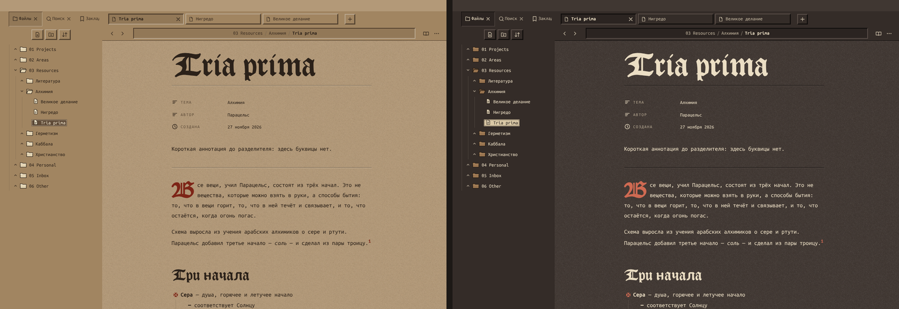

# Ars Memoria

Тема Obsidian от [NOEASY](https://noeasy.xyz): старинный гримуар, открытый в окне «Проводника» Windows 95. Есть светлая и тёмная версии, работает на iPhone и iPad без сети.

## Установка на iPhone и iPad

Нужен плагин BRAT.

1. Настройки → BRAT → **Add Beta Theme** (или палитра команд → «BRAT: Add a beta theme for testing»).
2. Вставь `agniglobal2021-cmd/obsidian-theme` и нажми **Add Theme**.
3. Настройки → Оформление → Темы → **Ars Memoria**.
4. Там же, в разделе «Шрифты», оставь поля шрифтов пустыми — иначе твои шрифты заменят шрифты темы.

Обновить: палитра команд → «BRAT: Check for updates to all beta themes».

## Что умеет тема

- **Название заметки** — в рамке-картуше: двойная тонкая рамка, название по центру, строки одинаковой длины. Набрано готикой Wolgadeutsche цветом текста.
- **Готика** — только у названия, H1, H2 и буквицы. Кавычки «», знаки № и … в готике — из Ubuntu Mono Bold: в Wolgadeutsche «» нарисованы как "", а № и … нет. H3–H6 — моноширинные капители с разрядкой, без жирного; H4 киноварью.
- **Буквица** — одна на заметку, на две строки: верх по заглавным первой строки, низ по линии второй. Открывающая кавычка у буквицы не рисуется. Тема ставит буквицу сама: первая буква первого абзаца после первого `---`. Между заголовком и этим `---` удобно держать свойства и сведения о заметке. Перед `---` оставляй пустую строку, иначе Markdown сделает строку над ним заголовком.
- **Разделитель `---`** — вдавленная бороздка.
- **Цитата `>`** — врезка курсивом по центру между двумя бороздками.
- **Выноски** — вдавленные панели; цвет типа — средневековый пигмент: сепия, ярь-медянка, охра, киноварь, лазурит, сажа.
- **Картинки** — вклейка-гравюра в двойной рамке. Подпись — текст после черты: `![[Rubedoexe.jpg|Rubedo.exe]]` → «ИЛЛ. RUBEDO.EXE». Без подписи — только рамка.
- **Списки** — пиксельный крест паттэ киноварью, глубже тире и точка; номера киноварью.
- **Чекбоксы** — вдавленное окошко Win95 с пиксельной галочкой.
- **Таблицы** — книжные линейки, первый столбец киноварью.
- **Рамка окна** — Win95: выпуклые кнопки, вкладки-кнопки (открытая вдавлена), путь к заметке во вдавленном поле, папки Win95.
- **Диалоги** — выпуклые окна с готическим названием и бороздкой. На iPad небольшие окна закрываются касанием мимо окна.
- **Пустой экран** — логотип NOEASY.
- **Граф** — звёздная карта: сетка астролябии за точками заметок.
- **Шум** — мерцает, как на noeasy.xyz, только на листе заметки. В плагине Style Settings → Ars Memoria его можно остановить («Неподвижный шум») или убрать («Без шума на листе»). При «Уменьшении движения» в настройках iOS шум стоит на месте.
- **Ширина текста и поля** — как в стандартной теме Obsidian.
- **Ссылки** — жирные, без подчёркивания: позолота в светлой теме, киноварь в тёмной. Ссылки на заметки, которых ещё нет, бледнее; у ссылок на сайты — пиксельная стрелка.
- **Настройки** — в плагине Style Settings → Ars Memoria: акцентный цвет и цвет ссылок, отдельно для светлой и тёмной темы. Кнопка ↺ рядом с цветом возвращает исходный.

Цвета разделов в графе задаются в настройках графа → «Группы»: тема этого не умеет.

## Правка темы

Исходник — `src/theme.src.css`. После правки собери тему: `python3 src/build.py` — шрифты, шум, логотип и значки вшиваются в `theme.css`. Править `theme.css` руками не нужно.

Релиз: вкладка Actions → «Выпустить релиз» → Run workflow. Перед этим подними версию в `manifest.json`, `versions.json` и добавь запись в `CHANGELOG.md`.

## Лицензии

- Код темы — MIT, см. `LICENSE`.
- Wolgadeutsche — © Serg Shishin (justreyb), 2023, бесплатно для личного и коммерческого использования (`src/assets/fonts/Wolgadeutsche-readme.txt`). Поддержать автора: https://justreyb.gumroad.com/l/Wolgadeutsche, страница шрифта: https://www.behance.net/gallery/190682841/Wolgadeutsche-Free-Font.
- Ubuntu Mono — Ubuntu Font Licence 1.0, © Canonical (`src/assets/fonts/UbuntuMono-UFL.txt`).
- Логотип NOEASY и иллюстрации — все права у автора, не входят в лицензию MIT.
